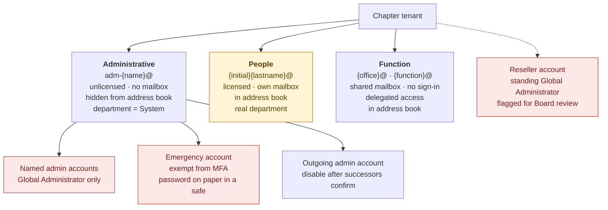
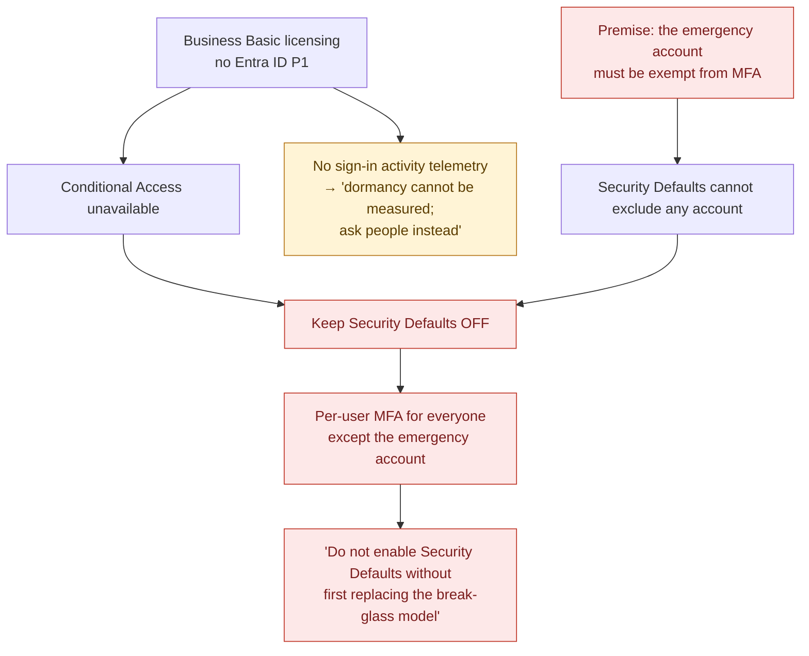
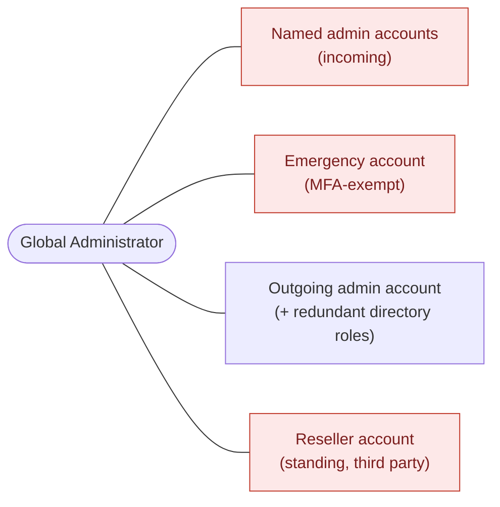
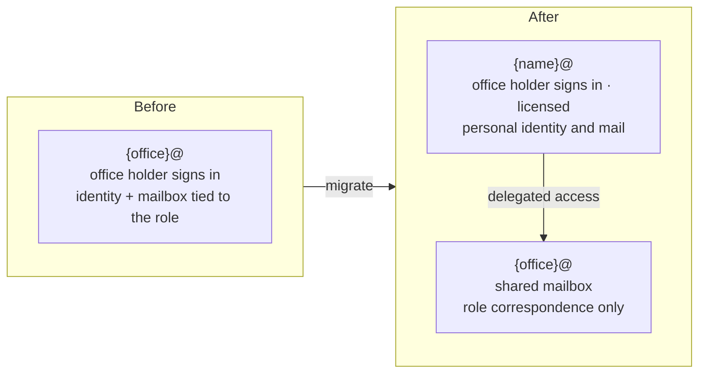
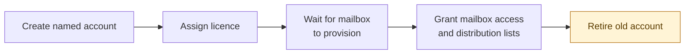
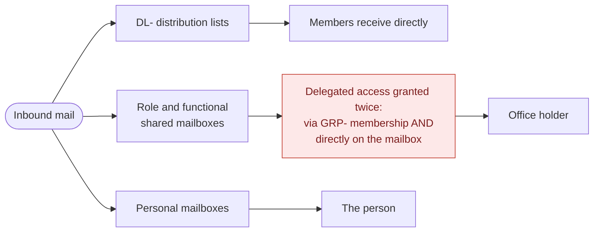
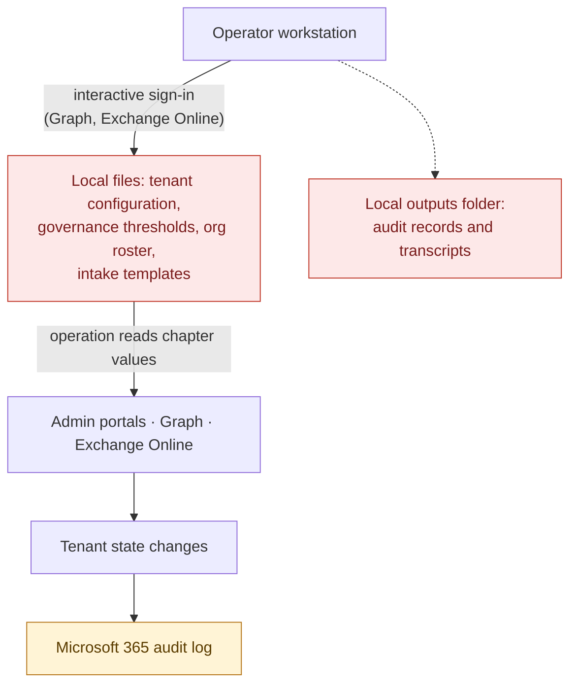

# August 2026 Microsoft 365 Handover — Sanitized Historical Record

**Historical period:** August 2026  
**Status:** Superseded source material; not current operating guidance  
**Archive owner:** Technology Administrator  
**Original records location:** Restricted chapter records repository  
**Review date:** August 7, 2026  
**Revised:** November 11, 2026 — legacy design captured and each recommendation assessed

## How to read this record

In August 2026 an outgoing technology leader handed PMISSC a Microsoft 365 packet: an architecture narrative, a set of architecture diagrams, a cutover runbook, an engagement closeout report, a letter to the Board, and an environment-status workbook. The packet also referred to configuration, roster, working-log, intake, and audit-output files that were not included in the reviewed set.

This record does two things:

1. **Captures the design the packet described**, with its diagrams redrawn in Mermaid, so future administrators can see what was proposed and the reasoning offered for it.
2. **Assesses every recommendation** as kept, corrected, or rejected, explains why, and points to the document that now governs.

Nothing here describes the live tenant. The packet's claims were unverified when received. Current state must be read from the tenant and recorded in the restricted records repository, not here.

**Diagram key:** red nodes were rejected; amber nodes were corrected. See [Assessment](#assessment-of-the-packets-recommendations).

### What was removed

In line with [SECURITY.md](../../SECURITY.md), this public record omits:

- names of people, and their named, privileged, and emergency-access account identifiers;
- specific role and functional mailbox addresses, shown here as `{office}@` and `{function}@`;
- the reseller's identity, group display names, and counts of users, administrators, directory roles, and migrations; and
- dates and details of internal incidents.

The original packet stays in the restricted records repository. If the files it referred to are recovered, they require security and records-management review before retention or use. Credential handoff files must never be added to Git.

## The legacy design as described

### 1. Account types

The packet's central idea: three kinds of account, kept separate so that phishing someone's everyday account does not hand an attacker control of the tenant.

Assessed in [A1](#a1), [A2](#a2), [A4](#a4), [A6](#a6), and [A7](#a7).

### 2. Emergency access and authentication

The packet argued that, without Entra ID P1, the only workable combination was per-user MFA with Security Defaults turned off. Its reasoning chain:

The whole chain rests on the premise, which is wrong. Assessed in [A4](#a4), [A5](#a5), and [A10](#a10).

### 3. Administrative access

The packet reported more Global Administrators than the chapter's own limit: the incoming named admin accounts, the emergency account, an outgoing admin account, and a reseller account. The outgoing account also held many other directory roles, which the packet correctly called redundant. It then gave the incoming accounts Global Administrator alone, describing this as "same capability, far easier to audit," and called the reseller's standing Global Administrator "normal for a licensing reseller relationship."

Assessed in [A4](#a4), [A6](#a6), and [A7](#a7).

### 4. From role-mailbox sign-ins to named accounts

Office holders had historically signed in *as* the role mailbox, so their identity, personal mail, and history all transferred with the office. The packet planned to give each office holder a named account and keep the role mailbox as a delegated shared mailbox. Most migrations were staged, not complete, when the packet was written.

Because an unlicensed account has no mailbox and is not a mail recipient, mailbox permissions and mail-enabled distribution lists cannot be applied until the licence is assigned. The packet's cutover order per person:

Assessed in [A1](#a1), [A3](#a3), and [A11](#a11).

### 5. Groups

The packet defined five prefixes, each with one job:

| Prefix | Packet meaning | Packet-reported status | Current standard |
|---|---|---|---|
| `LIC-` | Group-based licence assignment | In use | Kept, only where group-based licensing is active and verified |
| `ROLE-` | Who holds which chapter office | In use | Kept |
| `GRP-` | Resource access (SharePoint, shared mailboxes, apps) | In use | Replaced by `ACCESS-<Resource>-<Level>` |
| `ADM-` | Administrative grouping | Existed with members, but no directory role attached, so membership granted nothing | Prohibited unless role-assignable with the role attached ([A8](#a8)) |
| `DL-` | Mail distribution, never access | In use | Kept |

The packet proposed recreating the `ADM-` groups, because Microsoft only allows a group to be marked role-assignable when it is created. It also reported duplicate group memberships and two near-identical groups differing only by a misspelling, which it called "not harmful" ([A13](#a13)).

### 6. Mail flow and mailbox delegation

The packet called the double grant deliberate: in an earlier incident, a delegation that looked correct in the admin portal never appeared in the user's Outlook. Assessed in [A9](#a9).

### 7. Chapter data and administrative operations

The packet stressed that there were no stored credentials, no service accounts, and no unattended processes: every administrative action required a person to sign in and was attributable in the audit log. It kept chapter-specific values in configuration files so the Board could review them without reading code. Assessed in [A12](#a12), [A14](#a14), and [A15](#a15).

## Assessment of the packet's recommendations

| ID | Packet recommendation | Verdict | Current authority |
|---|---|---|---|
| A1 | Separate everyday, privileged, and role-mailbox identities | **Kept** | [Object naming §4](../../standards/microsoft-365/object-naming.md#4-object-type-boundaries); [Administrator transition §3](../../procedures/microsoft-365/administrator-transition.md#3-mandatory-safeguards) |
| A2 | Name people `{initial}{lastname}@`; admin domain unspecified | **Corrected** | [Object naming §3](../../standards/microsoft-365/object-naming.md#3-approved-patterns) |
| A3 | Assign the licence before mailbox permissions and distribution lists | **Kept** | [Shared mailbox handoff](../../procedures/microsoft-365/shared-mailbox-handoff.md) |
| A4 | Emergency account exempt from MFA; password on paper; annual validation | **Rejected** | [Administrator transition §3](../../procedures/microsoft-365/administrator-transition.md#3-mandatory-safeguards) |
| A5 | Keep Security Defaults off; rely on per-user MFA | **Rejected** | This record; implement after A4 is remediated |
| A6 | Give admins Global Administrator only, as "easier to audit" | **Rejected** | [Administrator transition §3](../../procedures/microsoft-365/administrator-transition.md#3-mandatory-safeguards) |
| A7 | Reseller standing Global Administrator is normal | **Rejected** | [Partner administrative access decision](../../decisions/2026-08-partner-administrative-access.md) |
| A8 | Recreate `ADM-` groups as role-assignable | **Corrected** | [Object naming §5](../../standards/microsoft-365/object-naming.md#5-administrative-group-safeguard) |
| A9 | Grant shared-mailbox access twice, through a group and directly | **Rejected** | [Shared mailbox handoff §4](../../procedures/microsoft-365/shared-mailbox-handoff.md#4-choose-the-permission-model) |
| A10 | Dormancy cannot be measured without P1; ask people instead | **Corrected** | [License and Access Register](../../templates/license-and-access-register.md#review-checks) |
| A11 | Retire the old position account at the end of cutover | **Corrected** | [Shared mailbox handoff §6–§9](../../procedures/microsoft-365/shared-mailbox-handoff.md#6-convert-an-eligible-user-mailbox) |
| A12 | Interactive administration only; no stored credentials or service accounts | **Kept** | [SECURITY.md](../../SECURITY.md) |
| A13 | Duplicate and misspelled groups are harmless | **Corrected** | [Object naming §6](../../standards/microsoft-365/object-naming.md#6-legacy-objects) |
| A14 | Keep chapter configuration, roster, and audit outputs in local files | **Rejected** | [SECURITY.md](../../SECURITY.md); [License and Access Register](../../templates/license-and-access-register.md) |
| A15 | The Microsoft 365 audit log is the lasting record of admin actions | **Corrected** | [Administrator transition §12](../../procedures/microsoft-365/administrator-transition.md#12-close-and-attest) |
| A16 | The packet and its status workbook reflect the live tenant | **Rejected as evidence** | [Claims requiring verification](#claims-requiring-independent-verification) |

### Why each correction or rejection

**A2 — naming.** The current standard uses `firstname.lastname@` for people and places privileged and emergency accounts in the cloud-only `onmicrosoft.com` domain, so they keep working if the custom domain, DNS, or federation breaks.

**A4 — MFA-exempt emergency account.** This is the packet's central error. Microsoft now [requires MFA to sign in to the Azure, Entra, Intune, and Microsoft 365 admin centres](https://learn.microsoft.com/en-us/entra/identity/authentication/concept-mandatory-multifactor-authentication), so an MFA-exempt Global Administrator cannot reach the admin portals: it fails in exactly the emergency it exists for. Microsoft's [emergency-access guidance](https://learn.microsoft.com/en-us/entra/identity/role-based-access-control/security-emergency-access) is two or more cloud-only emergency accounts using phishing-resistant MFA (a FIDO2 security key, passkey, or certificate), credentials held by separate custodians, alerts on every sign-in, and validation at regular intervals of no more than 90 days. A printed password alone can be photographed, is not phishing-resistant, and leaves no trail of who used it.

**A5 — Security Defaults off.** This exists only to protect A4's premise. Once emergency accounts use MFA, nothing needs an exclusion. Per-user MFA is the legacy control: it does not block legacy authentication protocols that cannot perform MFA, which [Security Defaults](https://learn.microsoft.com/en-us/entra/fundamentals/security-defaults) does. Rebuild the emergency accounts first, then enable Security Defaults, or Conditional Access if P1 is acquired.

**A6 — Global Administrator only.** Removing the redundant roles was right. Replacing them with Global Administrator inverts least privilege: every admin session then carries full tenant control. Microsoft [recommends](https://learn.microsoft.com/en-us/entra/identity/role-based-access-control/best-practices) the narrowest role for each task and fewer than five Global Administrators. The chapter reserves Global Administrator for emergency access and tasks no narrower role can perform.

**A7 — standing reseller access.** Standing partner Global Administrator is the legacy delegated-admin model. Microsoft replaced it with [granular delegated admin privileges](https://learn.microsoft.com/en-us/partner-center/customers/gdap-introduction), which are least-privilege and time-bound. Standing third-party access sits outside the chapter's MFA, monitoring, and offboarding. The Board decision record covers the options.

**A8 — recreating `ADM-` groups.** The diagnosis was right: the role-assignable flag can only be set when a group is created. The remedy is not available as described, because [assigning Entra roles to groups requires Entra ID P1](https://learn.microsoft.com/en-us/entra/identity/role-based-access-control/groups-concept), which the packet says the tenant lacks. Without P1, retire or rename the decorative `ADM-` groups after dependency review, assign narrow roles directly to privileged accounts, and record them in the License and Access Register.

**A9 — double mailbox grants.** The Outlook symptom has a documented cause rather than a tenant fault: Full Access granted through a group does not automap the mailbox in Outlook, while a direct grant does. Keeping both paths means removing someone from the group silently leaves the direct grant in place, so offboarding fails without warning. The current procedure uses direct named delegation by default.

**A10 — dormancy.** Graph's per-user sign-in activity does require P1. The Microsoft 365 admin centre usage reports (last activity per user and service) and audit log search do not, and should be used before relying on people to self-report. *Confirm current report availability, and whether user names are concealed in the report settings, before relying on this.*

**A11 — retiring the old account.** The position account's mailbox belongs with the office. Convert it to a shared mailbox and keep it; do not retire it. It may already hold a previous office holder's personal correspondence alongside chapter records, so review it for records before delegating it to a successor.

**A13 — near-duplicate groups.** Groups that differ only by a misspelling, and duplicate memberships, cause mail and access to be granted to the wrong object and make reviews unreliable. Retire them after dependency review.

**A14 — local files.** A roster of people, accounts, and licences, plus audit transcripts, held on an operator workstation or in a handover folder is personal data outside records control, and it leaves with the operator. Populated inventories belong in the restricted records repository and the License and Access Register. Keeping configuration separate from procedure was a sound idea; the storage location was not.

**A15 — audit log retention.** Microsoft 365 Audit (Standard) keeps records for a limited period (180 days at the time of writing), not indefinitely. Export any evidence that must outlast that period into the restricted records repository.

**A16 — packet as evidence.** The packet was a point-in-time snapshot by a departing operator. It is useful as a lead, not as evidence of current state.

## Claims requiring independent verification

Before remediation or closure, administrators should query the live tenant and contract records to determine:

- current privileged-role assignments;
- emergency-access account configuration and validation status;
- partner or reseller delegated access;
- resource ownership and backup ownership;
- licence availability and mailbox eligibility;
- role-mailbox and named-account use;
- ineffective, duplicate, misspelled, or deprecated groups; and
- outstanding records-preservation or account-transition work.

The populated results belong in the restricted records repository and the License and Access Register, not in this archive record.

## Current authority

Current policies, procedures, standards, templates, and approved decision records in this repository supersede the handover packet. When a repository document conflicts with current Microsoft requirements, law, contract, or Board action, the conflict must be escalated and the document corrected rather than followed blindly.
